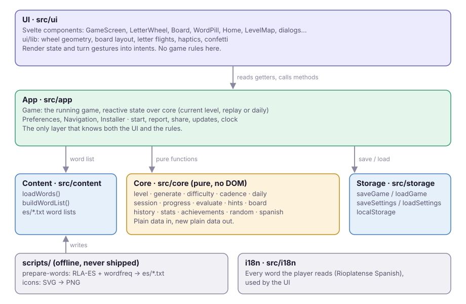
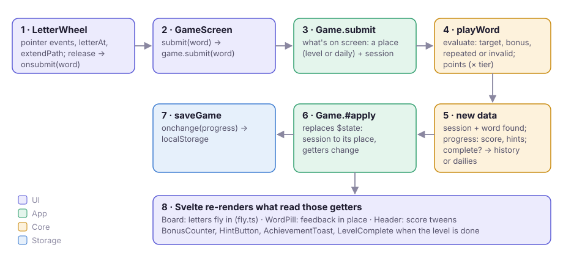
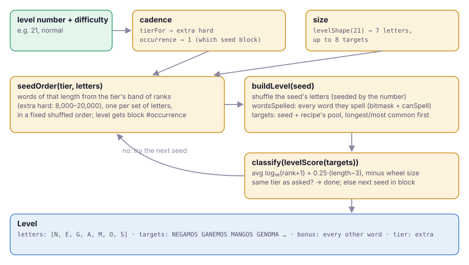

# How it works

Grama is a static web app: no server, no accounts. The browser downloads the app and
three word lists once; after that every level is generated on the device, progress is
saved in `localStorage`, and a service worker keeps it all working offline.

## The big picture

Dependencies point down: **UI → app → core, content, storage**. `core` imports nothing
from the rest, and nothing in `core` touches the DOM, the clock or storage.

| Layer   | Folder        | Its job                                                          | Rule                                       |
| ------- | ------------- | ---------------------------------------------------------------- | ------------------------------------------ |
| UI      | `src/ui`      | Draw state, turn gestures into intents                           | No game rules                              |
| App     | `src/app`     | Wrap the rules in reactive state; screens, settings, the browser | The only layer that knows both sides       |
| Core    | `src/core`    | The game's rules, as pure functions over plain data              | No DOM, no time, no storage, no randomness |
| Content | `src/content` | The word lists, loaded and ranked                                | Data in, data out                          |
| Storage | `src/storage` | Saving progress and settings                                     | The only code that touches `localStorage`  |
| UI text | `src/i18n`    | Every word the player reads, in Rioplatense Spanish              | No text hard-coded in components           |
| Offline | `scripts/`    | Build the word lists and icons                                   | Never shipped to players                   |

## Core, piece by piece

### Levels are plain data

A {@link "core/level"!Level | Level} is its wheel's letters, its targets (the board), its bonus
words (everything else the letters spell) and its tier. Words are stored **normalized**:
uppercase, accents removed, `Ñ` kept ({@link "core/spanish"!spanish | spanish}). How a word is
_written_ (with accents) is a separate lookup the app does for display.

{@link "core/level"!levelProblems | levelProblems} spells out what a valid level is; generated levels are
tested against it.

### A level is generated, never stored

{@link "core/generate"!generateLevel | generateLevel} turns a word list, a level number, a tier and an
occurrence into a level, deterministically: the same inputs give the same level on any
device. {@link "core/cadence"!tierFor | tierFor} decides the tier from the level number and the
player's difficulty setting; the [Difficulty guide](./difficulty.md) explains the score,
the tiers and how seeds are chosen so levels don't repeat.

### Playing is a session plus progress

Two kinds of state, both plain data:

- A {@link "core/session"!Session | Session} is one level in play: the words found and the letters
  hints revealed. Main levels, replays and daily challenges all use one.
- {@link "core/progress"!Progress | Progress} is the player: current level, score, hints, difficulty,
  the main level's session, the history of completed levels and the dailies.

{@link "core/progress"!playWord | playWord} plays a word on _any_ session: it asks
{@link "core/evaluate"!evaluate | evaluate} what the word is (target, bonus, repeated, invalid), adds
it to the session, and gives the player what it earned (points, progress toward a hint,
the level's record in the history when it completes). A
{@link "core/progress"!Place | Place} says where the level belongs (a numbered level or a dated
daily), so the record lands in the right place.

### Records and rewards

- {@link "core/history"!starsFor | starsFor} and {@link "core/history"!record | record}: stars, and the best
  of every play per level (most stars, fewest hints, most bonus words).
- {@link "core/stats"!statsOf | statsOf}: totals over the history and the dailies, plus every hint
  spent. Nothing in them can go down, so achievements stay unlocked.
- {@link "core/achievements"!ACHIEVEMENTS | ACHIEVEMENTS}: each one a stat reaching a goal.
- {@link "core/daily"!generateDaily | generateDaily} and {@link "core/daily"!streakOf | streakOf}: the daily challenge, and its streak with freezes.

## The app layer

{@link "app/game.svelte"!Game | Game} is the bridge. It holds {@link "core/progress"!Progress | Progress} in
Svelte `$state` and exposes **getters** (`board`, `score`, `canHint`, `stars`…) that
compute from it; anything the UI reads through a getter re-renders when the state
changes. Its methods (`submit`, `hint`, `next`, `replay`, `playDaily`…) call core and
replace the state.

`Game` starts without its words, so Home shows while they download (at low priority, so
the page and its font come first); the game screen waits for
{@link "app/game.svelte"!Game.ready | ready}.

`Game` knows what's on screen through its _mode_: the player's current level, a replay
of an earlier one (an in-memory session), or the daily challenge (its session saved in
`progress.daily`). Every getter and method works on "the level on screen", whichever it
is.

> [!TIP]
> **Why `level` returns the same object.** `level` is a `$derived` that regenerates only when the level number, difficulty or date changes, and otherwise returns the _same_ object. Svelte only updates what depends on a derived when its value changes, so the wheel keeps a shuffled order while the player finds words. (Regenerating on every word was a real bug.)

Around `Game`:

| Module                                      | Its job                                   |
| ------------------------------------------- | ----------------------------------------- |
| {@link "app/time-trial.svelte"!Trial        | Trial}                                    | A Contrarreloj run on screen (`core/time-trial`)         |
| {@link "app/preferences.svelte"!Preferences | Preferences}                              | Settings as reactive state, saved on every change        |
| {@link "app/navigation.svelte"!Navigation   | Navigation}                               | Which screen shows, tied to browser history (back works) |
| {@link "app/install.svelte"!Installer       | Installer}                                | The install prompt, or iOS instructions                  |
| {@link "app/start"!startState               | startState}                               | Resume the save, or jump to `?nivel=N`                   |
| {@link "app/report"!reportUrl               | reportUrl}, {@link "app/share"!shareText  | shareText}                                               | Reporting a level on GitHub; sharing the daily result |
| {@link "app/updates"!checkForUpdate         | checkForUpdate}, {@link "app/clock"!today | today}                                                   | A new version? What day is it?                        |

## The UI

Svelte components render what `Game` exposes and call its methods. TypeDoc can't read
`.svelte` files, so here's the map (each file starts with an `@component` comment):

| Component                                      | Shows                                                    |
| ---------------------------------------------- | -------------------------------------------------------- |
| `App`                                          | Loads words, picks the screen, applies theme and mode    |
| `TrialScreen`                                  | Contrarreloj: the clock, a wheel, Pasar, the summary     |
| `Home`, `LevelMap`, `StatsScreen`              | The hub, the map with replays, achievements and stats    |
| `GameScreen`                                   | A level: wires the pieces below and the dialogs          |
| `Header`, `Board`, `WordPill`, `LetterWheel`   | Level and score, the rows, the word being spelled, input |
| `HintButton`, `BonusCounter`                   | The two controls by the wheel                            |
| `Dialog` and its users                         | Menu, tutorial, level complete, about, report, …         |
| `AchievementToast`, `Confetti`, `UpdatePrompt` | Things that pop up                                       |

`ProgressScreen` shows personal rating, trend and recent results; `RatingChart` draws
its small SVG history with a spoken equivalent for every value.

The UI's own helpers are plain TypeScript in `src/ui/lib`:
{@link "ui/lib/wheel"!letterAt | letterAt} and {@link "ui/lib/wheel"!extendPath | extendPath} (the gesture),
{@link "ui/lib/board-layout"!boardLayout | boardLayout} (tile size), {@link "ui/lib/fly"!sendLetter | sendLetter} and
{@link "ui/lib/fly"!receiveLetter | receiveLetter} (letters flying into the board),
{@link "ui/lib/keyboard"!wheelKey | wheelKey} (typing), {@link "ui/lib/sound"!play | play} (sounds).

## Walkthrough 1: a drag becomes a scored word

1. `LetterWheel` listens to pointer events. On each move,
   {@link "ui/lib/wheel"!letterAt | letterAt} finds the letter under the finger and
   {@link "ui/lib/wheel"!extendPath | extendPath} adds it (or undoes the last one). On release it calls
   `onsubmit(word)`.
2. `GameScreen.submit` calls {@link "app/game.svelte"!Game.submit | Game.submit}.
3. `Game` works out the place on screen and its session, and calls
   {@link "core/progress"!playWord | playWord}.
4. {@link "core/evaluate"!evaluate | evaluate} classifies the word; points get the tier's multiplier.
5. `playWord` returns a new session and new progress. If the level still
   {@link "core/progress"!pays | pays} (it isn't a replay): the score, a step toward a hint for a
   bonus word, a hint for finishing an extra-hard level; the session keeps what it paid,
   which Level Complete shows. Either way, a completed level gets its record in the
   history.
6. `Game` puts the session back where it belongs (current level, replay or daily) and
   replaces its `$state`.
7. The change goes to `onchange`, which `App` wired to
   {@link "storage/save"!saveGame | saveGame}.
8. Svelte re-renders what read the changed getters: the `Board`'s new tiles fly in from
   the pill, the score tweens, the bonus counter pulses, and `LevelComplete` appears
   when `game.complete` turns true.

## Walkthrough 2: level 21 becomes a level

1. {@link "core/cadence"!tierFor | tierFor}(21, `normal`) says **extra hard** (the seventh in its
   cycle); the player's progress counts one extra-hard 7-letter level before it
   ({@link "core/progress"!currentPlace | currentPlace}), so it gets the second block of seeds.
2. {@link "core/generate"!levelShape | levelShape}(21, `extra`): 7 letters, up to 9 targets.
3. The extra-hard seed order holds 7-letter words ranked 8,000–20,000, one per set of
   letters, shuffled once (seeded, so always the same order).
4. For each seed in its block: shuffle the letters (seeded by the level number), find every
   word they spell, take the seed plus the longest words from the extra-hard pool as
   targets, score them with {@link "core/difficulty"!levelScore | levelScore}.
5. If {@link "core/difficulty"!classify | classify} says extra hard, done. Otherwise the next seed.

## Walkthrough 3: today becomes a daily challenge

1. Home reads {@link "app/game.svelte"!Game.today | Game.today}. `Game` reads the date from its clock
   ({@link "app/clock"!today | today}, unless a test passes another) when it starts, and again
   with {@link "app/game.svelte"!Game.refreshDate | refreshDate} when the app comes back to the
   foreground or a daily is opened, since a visit can cross midnight. From the date,
   {@link "core/daily"!dailyNumber | dailyNumber} gives its number,
   {@link "core/daily"!dailyTier | dailyTier} its weekday tier and {@link "core/daily"!streakOf | streakOf} the streak.
2. "Desafío del día" calls `game.playDaily()`: the mode becomes the daily, and
   {@link "core/daily"!generateDaily | generateDaily} builds a 7-letter level from seeds at the far end
   of the tier's order, away from the main levels'.
3. Words are played exactly as in walkthrough 1, with a `daily` place: the session is saved
   in `progress.daily`, and completion is recorded in `progress.dailies` under the date.
4. "Compartir" builds the text from the daily on screen
   ({@link "app/game.svelte"!Game.dailyOnScreen | dailyOnScreen}: its own date, even if it's
   past midnight) and calls {@link "app/share"!shareText | shareText}.

## Storage and offline

- {@link "storage/save"!saveGame | saveGame} stores {@link "core/progress"!Progress | Progress} with a version
  number; pre-1.0 an older version is simply discarded (D5, D15). It also stores
  {@link "core/generate"!LEVELS_VERSION | LEVELS_VERSION}: when the levels have changed since, the
  progress stays but the levels in play start over.
- {@link "storage/settings"!loadSettings | loadSettings} keeps each setting it understands and defaults
  the rest, so new settings never wipe old ones.
- The Contrarreloj record ({@link "storage/trials"!saveTrials | saveTrials}) and Tu diccionario
  ({@link "storage/dictionary"!saveDictionary | saveDictionary}) have keys of their own, so a new
  save version never wipes them (D19, D24).
- The service worker (`vite-plugin-pwa`) precaches the app and the word lists. Its offline
  fallback must not answer for `/guia/` and `/docs/`, which are separate sites under the
  same path (`navigateFallbackDenylist` in `vite.config.ts`).

## Where to start reading

1. `src/core/level.ts` and `src/core/session.ts`: the data.
2. `src/core/progress.ts`: what playing a word does.
3. `src/app/game.svelte.ts`: how that reaches the screen.
4. `src/ui/components/GameScreen.svelte`: how the screen is wired.
5. `src/core/generate.ts` with the [Difficulty guide](./difficulty.md): where levels come
   from.
6. `docs/GAME.md` for the rules as a player sees them, `docs/DECISIONS.md` for why.

## Assessment contract (M21–M22)

For the M23 estimator work, see [Skill model candidates](./skill-model.md).

`core/assessment/attempt` defines original evidence independently of a game: attempt
identity and local sequence, game/track/mode, rules/content versions, supplied timestamps,
active duration and timing quality, exposures, and completion with a game-specific result.
Active attempts include pauses and reloads; abandoned attempts are retained without
being treated as losses. Assistance remains in the outcome for a future model.

`app/assessment/grama` supplies puzzle identity and result payloads. Inputs use Level's
normalized words. Exact identity retains targets; exposure groups all puzzles with the
same letter multiset, even across modes, target changes and generator versions. Familiar
words on a different wheel are ordinary learned skill, not recognized replay content.

The storage transaction calls `exposureFor` before showing each puzzle and persists its
returned classification. Encounter IDs must survive resume and be new on restart; each trial
wheel gets its own encounter, even within one run. First exposure means first in the
recording ledger, not a claim about play before recording existed. Saved unknown exposures
retain their classification after a reload or reset.
`eligibilityOf` excludes unfinished attempts, any repeated or unknown exposure, missing
exposure and uncertain timing. Admission is not a claim of measured skill: difficulty,
outcome calibration and statistical independence are later model responsibilities.

Numbered levels, dailies and map replays now use `app/assessment/recorder`. Contrarreloj now records one attempt per run with every
wheel, including skipped ones. Both tracks share the same `Recording` handle, monotonic
clock, write queue, preparation timeout and exposure ledger. Existing Session/Progress and generated
levels do not change, and no skill rating is calculated or displayed yet.

### Puzzle recording at the browser edge

`Game.observation` copies plain puzzle/session data at accepted submissions and hints.
`Game.recordingKey` changes only for a different place, mode or explicit reset. GameScreen
reads it through `$derived`: a word/hint replaces Progress, but the unchanged derived
string prevents the preparation effect from restarting on every interaction.

`GramaRecorder.prepare` serializes work, finds the latest unfinished checkpoint for the
same place and replay flag, and reconciles its content and session. A matching session
resumes the encounter; a save ahead of its checkpoint retains identity with uncertain
timing. A reset, backward session or changed content abandons the old encounter and
creates another. Map replays get new repeated encounters and are abandoned when left.
An already completed save never fabricates a new performance.

The first checkpoint commits exposure before the board renders, with `presented: false`.
The first UI observation acknowledges presentation. A reload of an unacknowledged
checkpoint is uncertain: storage may have completed after the UI timed out. Preparation
waits at most two seconds, then disables recording for the visit and releases ordinary
play. Conflicts and failed updates stop that recording handle; progress saving remains
independent. If IndexedDB fails, a best-effort localStorage marker (`grama.assessment-gap`)
keeps later unseen content unknown. If both stores are blocked, the marker cannot persist.

Exposure tracking starts with recorded play for all profiles. Old game saves, tutorial
settings, trial results and dictionary entries do not create a separate recording policy.
Past plays are not reconstructed; existing observation classifications remain untouched.
Known game replays and repeated content in the ledger remain excluded, as do unknown
exposures caused by partial sessions or recording gaps.

Timing combines document visibility, navigation, completion and blocking dialogs, including
their closing transitions. A heartbeat every five seconds counts foreground thinking even
without input. More than fifteen seconds between running samples signals an unobserved
suspension: keep known time and mark it uncertain. This detects stalled observation,
not player inactivity. Page hide pauses; restoration uses a new monotonic visit ID.
Queueing preserves the captured event order; redundant pending heartbeats are coalesced.

### Trial recording

`Trial.observation` copies the seed, remaining countdown, aggregate result and ordered
wheel history. `playTrialWord` returns the played session even when it clears the board,
so the adapter retains the final word before the next wheel replaces it. Each wheel
keeps its original puzzle snapshot and cleared/skipped/current outcome; the last wheel
remains current when time expires. Accepted words are recorded, not animation frames.

`GramaRecorder.prepareTrial` creates a separate attempt for each run. Subsequent wheels
append exposure in the same transaction as their snapshots. The board and countdown
wait for this commit; the two-second fallback releases play if storage is unavailable.
Preparation does not consume game time or observed active time. After a failed trial
recording, play continues without collecting partial later wheels into another attempt.
`watchActivity` supplies the same visibility/dialog boundaries to both screens.

Time-up completes once, leaving the screen abandons the run, and “Otra vez” creates a
fresh ID even if the random seed repeats. A reload never resumes a trial. If shutdown
prevents its final write, its checkpoint remains unfinished and excluded; another tab
does not guess whether that run is still live or finalize it. Separate tabs own separate
run IDs, while exposure classification remains transactional across all modes. A run
with any repeated wheel, including within the run, is excluded by `eligibilityOf`.

The temporary marker for every trial opening has been removed. Recorded unknown exposures
remain unknown; recording new trials cannot reconstruct old exposures. `payload` combines both adapters' guards, so mixed puzzle/trial records share
the existing schema without wiping or changing the format of prior puzzle observations.

### Difficulty snapshots and timing checkpoints

`describePuzzle` in `app/assessment/grama` returns descriptor version 1 with exact and
exposure identities, wheel size, target count, target words/lengths/ranks, the level's
original tier, and the existing `levelScore`. Supply a rank map built once from the
loaded word-list order (zero-based). A missing or invalid rank stays null; an incomplete
or empty target list has no aggregate score. Descriptor version defines the feature
formula; the attempt's content version identifies the word data. These snapshots
are stored with observations rather than recalculated from a later dictionary.
For Contrarreloj, retain a descriptor for every presented wheel, including skipped ones.

`core/assessment/timing` owns the pure clock transitions. Pass monotonic samples and a
fresh visit ID for each browser clock domain, with epoch timestamps kept separately
for display. `NEW_TIMING` waits paused until content is ready, visible and interactive.
The app must combine all pause reasons: closing a dialog while hidden must not resume.

| App event                                                   | Timing transition                                       |
| ----------------------------------------------------------- | ------------------------------------------------------- |
| Ready and interactive, or returning to an unfinished puzzle | `resume`                                                |
| Submission/hint/checkpoint while playing                    | `checkpoint`                                            |
| Hidden, blocking dialog, or leaving a numbered/daily puzzle | `pause`                                                 |
| Completion or leaving a trial                               | `finish` (attempt is completed or abandoned separately) |
| Reading a persisted clock into a new app visit              | `restore` before `resume`                               |
| Unexplained suspension or lost observation interval         | `interrupt`, then `resume` when interactive             |

Every running transition accounts only for the interval since its last accepted sample.
Duplicate samples add zero; paused checkpoints add nothing; finalization is terminal.
Invalid/backward samples or a changed visit cannot produce elapsed time. A restored
running clock loses only its unmeasured tail and becomes uncertain; accumulated time
survives. A paused checkpoint has no active gap, so it can resume in a new visit without
uncertainty. Uncertainty never clears on resume. Foreground thinking counts: the app
must not infer distraction or suspend assessment solely from absent input. The reducer
cannot detect silent operating-system suspension from two apparently valid samples;
the app reports `interrupt` when continuity is not known. A conflicting tab stops writing its
recording handle; restoring a running checkpoint in another tab marks it uncertain.

Before storing an attempt, validate imported/checkpoint data in the storage layer,
copy `activeMs` and `timing` from its clock, and finalize at most once by attempt ID.
A full checkpoint must reconcile clock, encounter IDs, exposure classification and game
session; a mismatch or pre-instrumentation partial save is uncertain. Existing saves
contain no such observations. Wall-clock timestamps never supply missing active time.

### Personal performance projection (M24 cycle 1)

`app/assessment/performance.performanceHistory` validates original finalized history,
deduplicates attempt IDs and orders by saved sequence. It feeds numbered/daily puzzle
features into `core/assessment/performance` benchmark matches, updates the existing
Glicko-2 engine once per rated puzzle, and summarizes the current rating/trend.
The returned versioned view includes chronological puzzle results (practice or missing
difficulty has no update), Glicko rating snapshots, current rating, trend and separate trial history/best.
It writes nothing and needs no clock, random source or current dictionary. Missing timing
omits only the bounded time adjustment; unknown exposure stays recorded as unknown.
See the [formula and worked examples](./skill-model.md#performance-version-2).

`ProgressScreen` loads the projection on entry and renders the rating, trend and recent
results. `RatingChart` renders a small SVG with spoken values. Read/calculation failures
show retry without blocking navigation. Empty modes and research diagnostics stay hidden.
Recorder and research eligibility rules stay independent.

### Assessment storage (M22)

`storage/assessment` opens `grama.assessment` at schema 2. Checkpoints and finalized
attempts are keyed by `attempt.id`, each with a unique `attempt.sequence` index.
Exposures are keyed by encounter ID with a content-key index and immutable attempt owner.
Metadata holds the schema version and last allocated sequence. Unsupported older/newer
schemas are preserved and refused; there is no migration or automatic reset. Existing
localStorage game progress is independent.

`openAssessment` takes separate payload and completed-result guards; Grama supplies
combined guards for puzzle and trial variants. Record version 2
wraps an attempt, clock and JSON game snapshot with a revision. Shared validation checks
IDs, versions, counters, finite times, exposure and timing consistency. The adapter guards
validate game-specific state/challenge snapshots and results.
Dates, Maps, functions, undefined values and cycles are not evidence payloads. Restoring
a running checkpoint still requires the pure timing `restore` transition.

A new checkpoint proposes revision/sequence zero. First save allocates a sequence and
revision 1 atomically; later saves supply the last saved revision and receive its increment.
Use the entire returned canonical checkpoint. Stale writers conflict, identity cannot
change, time cannot decrease, prior exposure cannot disappear and uncertain timing cannot
become reliable. A failed write rolls back sequence allocation and exposure changes too.

Exposure classification happens inside the transaction, including other wheels in the
same write. Concurrent fresh encounters cannot both claim first exposure. Resuming an
encounter retains its classification, while reusing its ID in a different attempt or
with changed content conflicts. The ledger owner is database metadata, not a game field.

To finish, submit a `Finalized` proposal with the expected checkpoint revision, a finished
clock and completed/abandoned status. Completion carries a validated result; abandonment
carries none. Finalization validates against the checkpoint, commits final snapshot and
exposures, and removes the checkpoint in one transaction. Identical retries return the
existing outcome even after the checkpoint has gone; different evidence conflicts.
Object key order does not affect retry equality; array order does. A finished attempt
cannot accept any checkpoint write. Exposure history survives both completion and abandonment.

`loadAttempt` validates an immutable outcome by ID. `history(afterSequence)` returns at
most 100 records in creation-sequence order, after the supplied sequence. It is pagination,
not a change feed: an attempt created earlier can finish later, so consumers must refresh
ordered history (and later recompute projections) when that happens. Never use wall-clock
changes to reorder observations. Sequence counters are never allocated again on retry.

Every operation returns explicit results for unavailable/blocked storage, unsupported
schemas, invalid data, conflicts or transaction failures. Call `close` on teardown;
version changes close connections automatically, including late blocked-open cleanup.
The store arbitrates revisions; numbered/daily recording stops a stale writer rather
than merging competing session observations. Trial tabs use separate run IDs. `checkpoints()` validates all unfinished
records for reconciliation.

Browser tests compile the actual module into an in-memory library bundle and serve it
only through a Playwright route. They use native IndexedDB on the production app's
origin in Chromium and WebKit, without adding a test hook or extra entry to the game.
