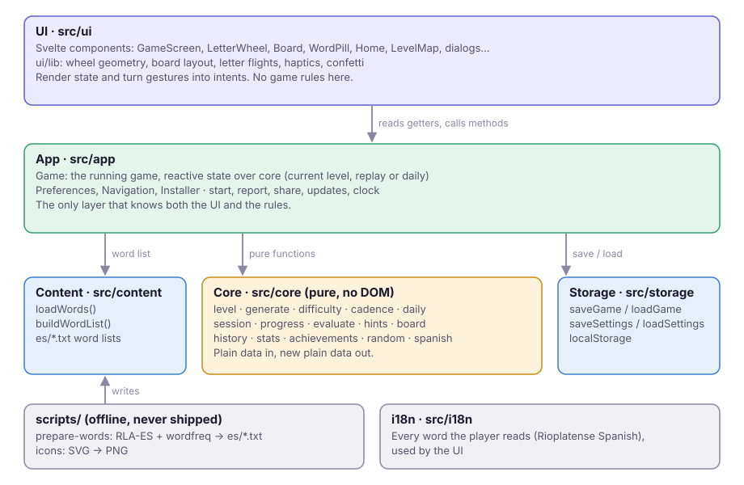
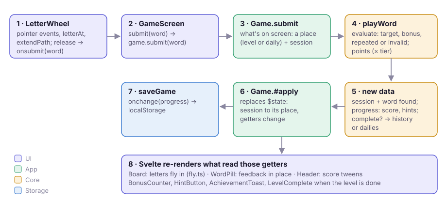
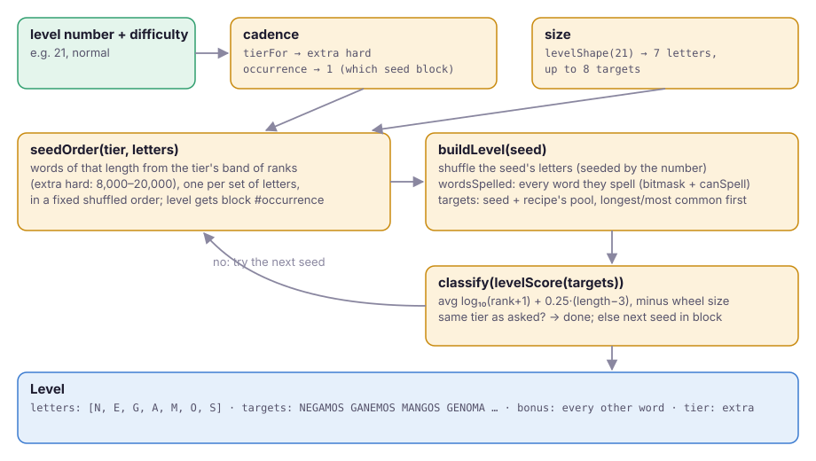

# How it works

Grama is a static web app: no server, no accounts. The browser downloads the app and
three word lists once; after that every level is generated on the device, progress is
saved in `localStorage`, and a service worker keeps it all working offline.

## The big picture

Dependencies point down: **UI → app → core, content, storage**. `core` imports nothing
from the rest, and nothing in `core` touches the DOM, the clock or storage.

| Layer   | Folder        | Its job                                                          | Rule                                       |
| ------- | ------------- | ---------------------------------------------------------------- | ------------------------------------------ |
| UI      | `src/ui`      | Draw state, turn gestures into intents                           | No game rules                              |
| App     | `src/app`     | Wrap the rules in reactive state; screens, settings, the browser | The only layer that knows both sides       |
| Core    | `src/core`    | The game's rules, as pure functions over plain data              | No DOM, no time, no storage, no randomness |
| Content | `src/content` | The word lists, loaded and ranked                                | Data in, data out                          |
| Storage | `src/storage` | Saving progress and settings                                     | The only code that touches `localStorage`  |
| UI text | `src/i18n`    | Every word the player reads, in Rioplatense Spanish              | No text hard-coded in components           |
| Offline | `scripts/`    | Build the word lists and icons                                   | Never shipped to players                   |

## Core, piece by piece

### Levels are plain data

A {@link "core/level"!Level | Level} is its wheel's letters, its targets (the board), its bonus
words (everything else the letters spell) and its tier. Words are stored **normalized**:
uppercase, accents removed, `Ñ` kept ({@link "core/spanish"!spanish | spanish}). How a word is
_written_ (with accents) is a separate lookup the app does for display.

{@link "core/level"!levelProblems | levelProblems} spells out what a valid level is; generated levels are
tested against it.

### A level is generated, never stored

{@link "core/generate"!generateLevel | generateLevel} turns a word list, a level number, a tier and an
occurrence into a level, deterministically: the same inputs give the same level on any
device. {@link "core/cadence"!tierFor | tierFor} decides the tier from the level number and the
player's difficulty setting; the [Difficulty guide](./difficulty.md) explains the score,
the tiers and how seeds are chosen so levels don't repeat.

### Playing is a session plus progress

Two kinds of state, both plain data:

- A {@link "core/session"!Session | Session} is one level in play: the words found and the letters
  hints revealed. Main levels, replays and daily challenges all use one.
- {@link "core/progress"!Progress | Progress} is the player: current level, score, hints, difficulty,
  the main level's session, the history of completed levels and the dailies.

{@link "core/progress"!playWord | playWord} plays a word on _any_ session: it asks
{@link "core/evaluate"!evaluate | evaluate} what the word is (target, bonus, repeated, invalid), adds
it to the session, and gives the player what it earned (points, progress toward a hint,
the level's record in the history when it completes). A
{@link "core/progress"!Place | Place} says where the level belongs (a numbered level or a dated
daily), so the record lands in the right place.

### Records and rewards

- {@link "core/history"!starsFor | starsFor} and {@link "core/history"!record | record}: stars, and the best
  result per level.
- {@link "core/stats"!statsOf | statsOf}: totals over the history and the dailies.
- {@link "core/achievements"!ACHIEVEMENTS | ACHIEVEMENTS}: each one a stat reaching a goal.
- {@link "core/daily"!generateDaily | generateDaily} and {@link "core/daily"!streak | streak}: the daily challenge.

## The app layer

{@link "app/game.svelte"!Game | Game} is the bridge. It holds {@link "core/progress"!Progress | Progress} in
Svelte `$state` and exposes **getters** (`board`, `score`, `canHint`, `stars`…) that
compute from it; anything the UI reads through a getter re-renders when the state
changes. Its methods (`submit`, `hint`, `next`, `replay`, `playDaily`…) call core and
replace the state.

`Game` knows what's on screen through its _mode_: the player's current level, a replay
of an earlier one (an in-memory session), or the daily challenge (its session saved in
`progress.daily`). Every getter and method works on "the level on screen", whichever it
is.

> [!TIP]
> **Why `level` returns the same object.** `level` is a `$derived` that regenerates only when the level number, difficulty or date changes, and otherwise returns the _same_ object. Svelte only updates what depends on a derived when its value changes, so the wheel keeps a shuffled order while the player finds words. (Regenerating on every word was a real bug.)

Around `Game`:

| Module                                      | Its job                                   |
| ------------------------------------------- | ----------------------------------------- |
| {@link "app/preferences.svelte"!Preferences | Preferences}                              | Settings as reactive state, saved on every change        |
| {@link "app/navigation.svelte"!Navigation   | Navigation}                               | Which screen shows, tied to browser history (back works) |
| {@link "app/install.svelte"!Installer       | Installer}                                | The install prompt, or iOS instructions                  |
| {@link "app/start"!startState               | startState}                               | Resume the save, or jump to `?nivel=N`                   |
| {@link "app/report"!reportUrl               | reportUrl}, {@link "app/share"!shareText  | shareText}                                               | Reporting a level on GitHub; sharing the daily result |
| {@link "app/updates"!checkForUpdate         | checkForUpdate}, {@link "app/clock"!today | today}                                                   | A new version? What day is it?                        |

## The UI

Svelte components render what `Game` exposes and call its methods. TypeDoc can't read
`.svelte` files, so here's the map (each file starts with an `@component` comment):

| Component                                      | Shows                                                    |
| ---------------------------------------------- | -------------------------------------------------------- |
| `App`                                          | Loads words, picks the screen, applies the theme         |
| `Home`, `LevelMap`, `StatsScreen`              | The hub, the map with replays, achievements and stats    |
| `GameScreen`                                   | A level: wires the pieces below and the dialogs          |
| `Header`, `Board`, `WordPill`, `LetterWheel`   | Level and score, the rows, the word being spelled, input |
| `HintButton`, `BonusCounter`                   | The two controls by the wheel                            |
| `Dialog` and its users                         | Menu, tutorial, level complete, about, report, …         |
| `AchievementToast`, `Confetti`, `UpdatePrompt` | Things that pop up                                       |

The UI's own helpers are plain TypeScript in `src/ui/lib`:
{@link "ui/lib/wheel"!letterAt | letterAt} and {@link "ui/lib/wheel"!extendPath | extendPath} (the gesture),
{@link "ui/lib/board-layout"!boardLayout | boardLayout} (tile size), {@link "ui/lib/fly"!sendLetter | sendLetter} and
{@link "ui/lib/fly"!receiveLetter | receiveLetter} (letters flying into the board).

## Walkthrough 1: a drag becomes a scored word

1. `LetterWheel` listens to pointer events. On each move,
   {@link "ui/lib/wheel"!letterAt | letterAt} finds the letter under the finger and
   {@link "ui/lib/wheel"!extendPath | extendPath} adds it (or undoes the last one). On release it calls
   `onsubmit(word)`.
2. `GameScreen.submit` calls {@link "app/game.svelte"!Game.submit | Game.submit}.
3. `Game` works out the place on screen and its session, and calls
   {@link "core/progress"!playWord | playWord}.
4. {@link "core/evaluate"!evaluate | evaluate} classifies the word; points get the tier's multiplier.
5. `playWord` returns a new session and new progress: score, a step toward a hint for a
   bonus word, and, if the level is complete, its record in the history (and a hint the
   first time an extra-hard level is completed).
6. `Game` puts the session back where it belongs (current level, replay or daily) and
   replaces its `$state`.
7. The change goes to `onchange`, which `App` wired to
   {@link "storage/save"!saveGame | saveGame}.
8. Svelte re-renders what read the changed getters: the `Board`'s new tiles fly in from
   the pill, the score tweens, the bonus counter pulses, and `LevelComplete` appears
   when `game.complete` turns true.

## Walkthrough 2: level 21 becomes a level

1. {@link "core/cadence"!tierFor | tierFor}(21, `normal`) says **extra hard** (the seventh in its
   cycle); the player's progress counts one extra-hard 7-letter level before it
   ({@link "core/progress"!currentPlace | currentPlace}), so it gets the second block of seeds.
2. {@link "core/generate"!levelShape | levelShape}(21): 7 letters, up to 8 targets.
3. The extra-hard seed order holds 7-letter words ranked 8,000–20,000, one per set of
   letters, shuffled once (seeded, so always the same order).
4. For each seed in its block: shuffle the letters (seeded by the level number), find every
   word they spell, take the seed plus the longest words from the extra-hard pool as
   targets, score them with {@link "core/difficulty"!levelScore | levelScore}.
5. If {@link "core/difficulty"!classify | classify} says extra hard, done. Otherwise the next seed.

## Walkthrough 3: today becomes a daily challenge

1. Home reads {@link "app/game.svelte"!Game.today | Game.today}: {@link "app/clock"!today | today} gives the
   local date, {@link "core/daily"!dailyNumber | dailyNumber} its number,
   {@link "core/daily"!dailyTier | dailyTier} its weekday tier, {@link "core/daily"!streak | streak} the streak.
2. "Desafío del día" calls `game.playDaily()`: the mode becomes the daily, and
   {@link "core/daily"!generateDaily | generateDaily} builds a 7-letter level from seeds at the far end
   of the tier's order, away from the main levels'.
3. Words are played exactly as in walkthrough 1, with a `daily` place: the session is saved
   in `progress.daily`, and completion is recorded in `progress.dailies` under the date.
4. "Compartir" builds the text from the result and calls {@link "app/share"!shareText | shareText}.

## Storage and offline

- {@link "storage/save"!saveGame | saveGame} stores {@link "core/progress"!Progress | Progress} with a version
  number; pre-1.0 an older version is simply discarded (D5, D15).
- {@link "storage/settings"!loadSettings | loadSettings} keeps each setting it understands and defaults
  the rest, so new settings never wipe old ones.
- The service worker (`vite-plugin-pwa`) precaches the app and the word lists. Its offline
  fallback must not answer for `/guia/` and `/docs/`, which are separate sites under the
  same path (`navigateFallbackDenylist` in `vite.config.ts`).

## Where to start reading

1. `src/core/level.ts` and `src/core/session.ts`: the data.
2. `src/core/progress.ts`: what playing a word does.
3. `src/app/game.svelte.ts`: how that reaches the screen.
4. `src/ui/components/GameScreen.svelte`: how the screen is wired.
5. `src/core/generate.ts` with the [Difficulty guide](./difficulty.md): where levels come
   from.
6. `docs/GAME.md` for the rules as a player sees them, `docs/DECISIONS.md` for why.
