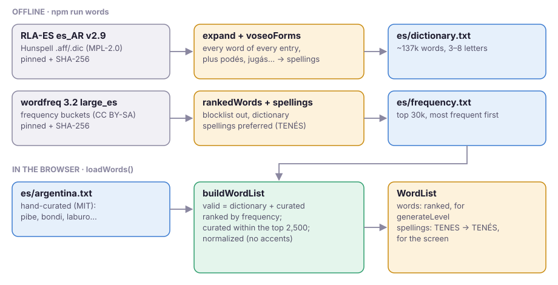

# Words

Which words exist, which are common, and how each is written: three questions answered by
three shipped files, built offline and combined in the browser.

## The sources

| File (in `src/content/es/`) | From                            | License      | Answers                  |
| --------------------------- | ------------------------------- | ------------ | ------------------------ |
| `dictionary.txt`            | RLA-ES Spanish (Argentina) v2.9 | MPL-2.0      | Which words exist        |
| `frequency.txt`             | wordfreq 3.2, `large_es`        | CC BY-SA 4.0 | How common they are      |
| `argentina.txt`             | Hand-curated for Grama          | MIT          | Everyday Argentine words |

The two derived files keep their licenses and carry attribution headers; they're never
merged into one (D12, `NOTICE.md`). The curated list is ours (D14).

## Building the lists (offline)

`npm run words` runs `scripts/prepare-words.ts`:

1. **Download** the pinned sources (cached in `.cache/`) and check their SHA-256, so the
   output is the same on every machine.
2. **Expand the dictionary.** Hunspell stores stems plus suffix and prefix rules
   (`scripts/hunspell.ts` parses and applies them): `gato/FS` becomes _gato, gatos, gata,
   gatas_. Then `scripts/voseo.ts` adds the voseo present and imperative forms it lacks
   (_podés, jugás_), from every verb whose gerund or imperfect is also in the dictionary.
3. **Rank by frequency.** wordfreq's data is buckets of words by frequency
   (`scripts/wordfreq.ts`); flattened, a word's position is its rank. Words on
   `scripts/blocklist-es.txt` (vulgar, offensive, read as names) are dropped here, so they
   can never be targets or seeds; they stay valid as bonus words if the dictionary has them.
4. **Choose spellings.** Words the game can't tell apart (they differ only in accents) are
   kept once, with one spelling (`scripts/words.ts`): a spelling the dictionary knows beats
   one it doesn't (wordfreq often drops accents: _tenes_ ranks above _tenés_), and between
   valid ones the accented one wins unless it's over 3× rarer
   (`preferSpelling`).
5. **Write** `dictionary.txt` (about 137k words of 3–8 letters, sorted) and
   `frequency.txt` (the top 30k, most frequent first), uppercase with accents.

## Using the lists (in the browser)

{@link "content"!loadWords | loadWords} fetches the three files (cached by the service worker)
and {@link "content/words"!buildWordList | buildWordList} turns them into a
{@link "content/words"!WordList | WordList}:

- **`words`**: every valid word, normalized and ranked
  ({@link "content/words"!rankWords | rankWords}). Valid means _in the dictionary or the curated
  list_; the frequency list only ranks. Frequent valid words come first, in frequency
  order; curated words are placed no lower than rank 2,500
  ({@link "content/words"!CURATED_RANK | CURATED_RANK}) so all of them can be targets; the rest of the
  dictionary follows. A word's index is its rank, which the generator and the difficulty
  score use directly.
- **`spellings`**: how each normalized word is written, for the screen (`TENES` →
  `TENÉS`).

## Changing the words

- **Block a word from targets:** add it to `scripts/blocklist-es.txt`, run
  `npm run words`.
- **Add an Argentine word:** add every form to `src/content/es/argentina.txt` (uppercase,
  accents). No rebuild needed.
- **Update a source:** change its URL and SHA-256 in `scripts/prepare-words.ts`, run
  `npm run words`, and check the real-data tests in `src/content/es/words.test.ts`
  (spellings, targets only from valid words, every curated word targetable, levels valid
  and in their tier).

Any change to the lists reshuffles levels; that's accepted before 1.0 (D5), but never
silent: the golden test in `words.test.ts` fingerprints levels 1–100 and 60 dailies and
fails until you bump {@link "core/generate"!LEVELS_VERSION | LEVELS_VERSION} along with its hash.
Saves from an older version keep the player's progress and start the levels in play over.
